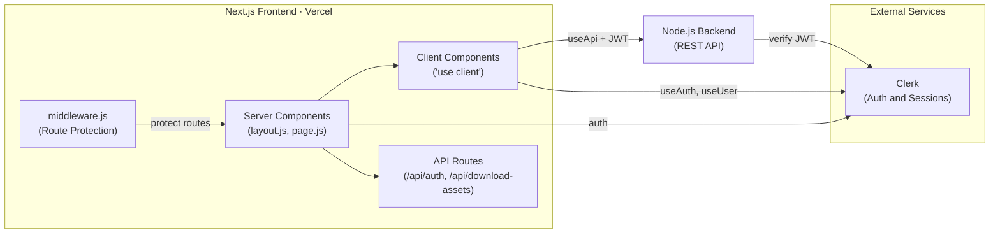

# En Passant Frontend

**The Official Chess Forum of ABES Engineering College**

[Live Site](https://enpassant.co.in) | [Report Bug](https://github.com/EnPassant-Chess-Forum-ABESEC/En-Passant-Client/issues) | [Request Feature](https://github.com/EnPassant-Chess-Forum-ABESEC/En-Passant-Client/issues)

---

## About

En Passant is a full-featured web platform for the chess community at ABES Engineering College. It provides a space for members to join the club, compete on leaderboards, attend events, and manage recruitment. 

This repository contains the frontend client, built with Next.js 16 (App Router) and deployed on Vercel. It communicates with a separate [Node.js backend](https://github.com/EnPassant-Chess-Forum-ABESEC/En-Passant-Backend) via authenticated REST APIs.

---

## Features

- **Cinematic Landing Page** — 3D chess pieces (React Three Fiber), GSAP scroll animations, smooth scrolling (Lenis), and a custom preloader.
- **Authentication** — Clerk-powered sign-in/sign-up with custom themed UI, animated page transitions, and a fast-signup API route.
- **Recruitment Pipeline** — Apply through a multi-step form, view assigned department tasks, submit solutions with file uploads, track deadlines with countdown timers, and monitor status from a personal dashboard.
- **Admin Dashboard** — Manage applications (list and Kanban views), tasks, departments, users, payments, queries, and recruitment settings (deadlines, open/close dates).
- **Leaderboard** — Global chess rankings with chess.com and Lichess rating integration.
- **Event Gallery** — Accordion gallery, masonry layout, and a drift wall for past and upcoming events.
- **Payments** — Manual UPI payment flow with an admin verification dashboard.
- **User Profiles** — Personal settings, chess rating cards, and public profile pages (`/u/[userName]`).
- **Analytics** — Vercel Analytics for page views and performance tracking.
- **Theming** — Dark/light mode support via `next-themes` with CSS variable design tokens.
- **SEO** — Dynamic `robots.txt`, `sitemap.xml`, Open Graph and Twitter Card metadata.

---

## Tech Stack

| Category | Technologies |
|---|---|
| **Framework** | Next.js 16.2 (App Router), React 19.2 |
| **Styling** | Tailwind CSS 3.4, shadcn/ui (base-nova), CSS Variables, `tailwindcss-animate` |
| **Design System** | Custom fonts (Inter, Pezula, PRFA Extrabold), brand-crimson color tokens |
| **Authentication** | Clerk (`@clerk/nextjs`, `@clerk/themes`) |
| **Animations** | Framer Motion 12, GSAP 3.15, Lenis 1.3 |
| **3D Graphics** | React Three Fiber 9, Drei 10, Three.js, OGL |
| **Charts** | Recharts 3 |
| **UI Primitives** | shadcn/ui, Base UI, Lucide React, React Icons, Sonner (toasts) |
| **Utilities** | clsx, tailwind-merge, class-variance-authority, date-fns, JSZip, FileSaver |
| **Component Registry** | [ReactBits](https://reactbits.dev) (configured in `components.json`) |
| **Deployment** | Vercel |

---

## Project Structure

```text
src/
├── app/                                     # Next.js App Router — all routes
│   ├── layout.js                            # Root layout (Clerk, Theme, Navbar, Footer, Analytics)
│   ├── page.js                              # Homepage — lazy-loaded sections
│   ├── globals.css                          # Global styles and CSS custom properties
│   │
│   ├── auth/
│   │   ├── layout.js                        # Shared auth layout with animated transitions
│   │   ├── sign-in/[[...sign-in]]/page.js   # Clerk sign-in (catch-all)
│   │   └── sign-up/[[...sign-up]]/page.js   # Clerk sign-up (catch-all)
│   │
│   ├── recruitment/
│   │   ├── page.js                          # Recruitment landing page
│   │   ├── apply/page.js                    # Multi-step application form
│   │   ├── dashboard/page.js                # Applicant dashboard (status, tasks, countdown)
│   │   └── department/[id]/page.js          # Department-specific tasks and submissions
│   │
│   ├── admin/
│   │   ├── layout.js                        # Admin layout with sidebar, role-gated server-side
│   │   ├── page.js                          # Main admin dashboard
│   │   ├── not-found.js                     # Access denied page
│   │   ├── recruitment/
│   │   │   ├── applications/page.js         # Applications (list + Kanban views)
│   │   │   ├── tasks/page.js                # Task management
│   │   │   ├── departments/page.js          # Department management
│   │   │   └── settings/page.js             # Recruitment settings (deadlines, dates)
│   │   ├── payments/recruitment/page.js     # Payment records
│   │   ├── queries/page.js                  # Contact form submissions
│   │   └── users/page.js                    # User management
│   │
│   ├── leaderboard/page.js                  # Chess rankings
│   ├── profile/page.js                      # User settings
│   ├── apply/page.js                        # Application form (legacy route)
│   ├── tasks/page.js                        # Task submission portal
│   ├── contact/page.js                      # Contact form
│   ├── event-gallery/page.js                # Club events
│   ├── u/[userName]/page.js                 # Public user profile
│   ├── privacy/page.js                      # Privacy policy
│   ├── terms/page.js                        # Terms of service
│   │
│   ├── api/
│   │   ├── auth/fast-signup/route.js        # Fast-signup API endpoint
│   │   └── download-assets/route.js         # Asset download API endpoint
│   │
│   ├── robots.js                            # SEO — robots.txt generation
│   ├── sitemap.js                           # SEO — sitemap.xml generation
│   └── not-found.js                         # Custom 404 page
│
├── components/
│   ├── ui/                                  # shadcn/ui primitives
│   │   ├── button.jsx
│   │   ├── card.jsx
│   │   ├── input.jsx
│   │   ├── select.jsx
│   │   ├── calendar.jsx
│   │   ├── datetime-picker.jsx
│   │   ├── alert-dialog.jsx
│   │   ├── popover.jsx
│   │   ├── label.jsx
│   │   └── sonner.jsx
│   ├── admin/                               # Admin-specific components
│   │   ├── AdminSidebar.js
│   │   ├── AdminSearchBar.js
│   │   ├── ApplicationsTab.js
│   │   ├── TasksTab.js
│   │   ├── UsersTab.js
│   │   ├── PaymentsTab.js
│   │   ├── QueriesTab.js
│   │   ├── DepartmentsTab.js
│   │   ├── KanbanTab.js
│   │   ├── SubmissionReviewDrawer.js
│   │   └── ThemeToggle.js
│   ├── auth/
│   │   └── AuthLayout.js                   # Shared auth page shell
│   ├── profile/
│   │   └── CustomProfileForm.jsx           # Profile edit form
│   ├── Navbar.js                            # Global navigation bar
│   ├── Footer.js                            # Global footer
│   ├── HeroSection.jsx                      # Landing page hero
│   ├── ChessCanvas.jsx                      # 3D chess piece renderer
│   ├── Preloader.jsx                        # Site loading animation
│   ├── SmoothScroll.jsx                     # Lenis smooth scroll wrapper
│   ├── LazyLoad.jsx                         # Intersection observer lazy wrapper
│   ├── ApplyForm.jsx                        # Recruitment application form
│   ├── TaskAccordion.jsx                    # Task list with expandable details
│   ├── TaskSubmissionModal.jsx              # File upload modal for submissions
│   ├── TaskCountdown.jsx                    # Task deadline countdown
│   └── ...                                  # 38 shared component files total
│
├── lib/
│   ├── api.js                               # useApi() — authenticated fetch hook
│   ├── utils.js                             # cn() — Tailwind class merger
│   └── clerkAppearance.js                   # Custom Clerk theme configuration
│
└── middleware.js                            # Clerk route protection middleware
```

---

## Routes and Access Control

### Public Routes

| Route | Description |
|---|---|
| `/` | Homepage — hero, stats, about, drift wall, journal |
| `/recruitment` | Recruitment landing page with timeline and departments |
| `/recruitment/department/[id]` | Department-specific tasks (viewable after applying) |
| `/event-gallery` | Event photo gallery |
| `/contact` | Contact and inquiry form |
| `/u/[userName]` | Public user profile |
| `/privacy` | Privacy policy |
| `/terms` | Terms of service |
| `/auth/sign-in` | Clerk sign-in |
| `/auth/sign-up` | Clerk sign-up |

### Protected Routes (require authentication)

| Route | Description |
|---|---|
| `/profile` | User settings and chess rating integrations |
| `/leaderboard` | Global chess rankings |
| `/apply` | Submit a recruitment application |
| `/recruitment/apply` | Multi-step recruitment application form |
| `/recruitment/dashboard` | Applicant dashboard — status, assigned tasks, deadlines |
| `/tasks` | View assigned tasks and submit solutions |

### Admin Routes (require authentication + admin role)

| Route | Description |
|---|---|
| `/admin` | Main admin dashboard |
| `/admin/recruitment/applications` | Applications management (list and Kanban views) |
| `/admin/recruitment/tasks` | Task management |
| `/admin/recruitment/departments` | Department management |
| `/admin/recruitment/settings` | Recruitment settings (deadlines, open/close dates) |
| `/admin/payments/recruitment` | Payment records |
| `/admin/queries` | Contact form submissions |
| `/admin/users` | User management |

Authentication is enforced at the middleware layer. The admin section performs an additional server-side role check — non-admin users see an "Access Denied" page.

---

## Architecture



### Key Architectural Decisions

| Decision | Rationale |
|---|---|
| Server Components by default | Pages in `src/app/` are server-rendered unless they need interactivity |
| Explicit Client Components | Any component using hooks, animations, or browser APIs declares `"use client"` |
| Authenticated API wrapper | `useApi()` automatically attaches Clerk JWT tokens and normalizes error responses |
| Lazy loading | Heavy homepage sections use `dynamic()` imports with `<LazyLoad>` intersection observer wrappers |
| Package optimization | Large libraries (Three.js, Framer Motion, icon packs) are tree-shaken via `optimizePackageImports` |
| CSS variable theming | All colors flow through CSS custom properties, enabling dark/light mode with zero JS runtime cost |
| Redirect normalization | `/sign-in` and `/sign-up` permanently redirect to `/auth/sign-in` and `/auth/sign-up` via `next.config.mjs` |

---

## Getting Started

### Prerequisites

- **Node.js** v18 or higher
- **npm** (comes with Node.js)
- The [En-Passant Backend](https://github.com/EnPassant-Chess-Forum-ABESEC/En-Passant-Backend) running locally on port `8080`

### Installation

1. **Clone the repository**

   ```bash
   git clone https://github.com/EnPassant-Chess-Forum-ABESEC/En-Passant-Client.git
   cd En-Passant-Client
   ```

2. **Install dependencies**

   ```bash
   npm install
   ```

3. **Set up environment variables**

   Create a `.env.local` file in the project root:

   ```env
   # Clerk Authentication
   NEXT_PUBLIC_CLERK_PUBLISHABLE_KEY=pk_test_...
   CLERK_SECRET_KEY=sk_test_...
   NEXT_PUBLIC_CLERK_SIGN_IN_URL=/auth/sign-in
   NEXT_PUBLIC_CLERK_SIGN_UP_URL=/auth/sign-up

   # Backend API
   NEXT_PUBLIC_API_URL=http://localhost:8080/api
   ```

4. **Start the development server**

   ```bash
   npm run dev
   ```

   The application will be available at [http://localhost:3000](http://localhost:3000).

### Available Scripts

| Command | Description |
|---|---|
| `npm run dev` | Start the development server with hot reload |
| `npm run build` | Create an optimized production build |
| `npm run start` | Serve the production build locally |
| `npm run lint` | Run ESLint with Next.js Core Web Vitals rules |

---

## Development Guidelines

### UI and Styling

- Use **Tailwind CSS** utility classes for all styling.
- Use **shadcn/ui** components from `src/components/ui/` before building custom ones. The project uses the **base-nova** style with a **neutral** base color.
- Use `cn()` from `src/lib/utils.js` to conditionally merge Tailwind classes:
  ```js
  import { cn } from "@/lib/utils";
  <div className={cn("base-class", isActive && "active-class")} />
  ```
- Add new shadcn components with `npx shadcn@latest add <component-name>`.
- Brand colors are available via `brand-crimson`, `brand-crimson-hover`, and `brand-crimson-dark` Tailwind tokens.

### Authentication

- **Client Components:** use `useUser()` or `useAuth()` from `@clerk/nextjs`.
- **Server Components:** use `auth()` from `@clerk/nextjs/server`.
- **API Calls:** use the `useApi()` hook — it auto-attaches JWT tokens and normalizes error responses:
  ```js
  const fetchApi = useApi();
  const users = await fetchApi("/users");
  ```
- **Protecting new routes:** add the route pattern to `isProtectedRoute` in `src/middleware.js`.

### Animations

| Use Case | Library |
|---|---|
| UI transitions, hover effects | Framer Motion |
| Complex scroll-driven sequences | GSAP |
| Smooth page scrolling | Lenis |
| 3D / WebGL elements | React Three Fiber + Drei |

> All animation and 3D components **must** declare `"use client"` at the top of the file.

### Adding New Pages

1. Create a folder under `src/app/` matching the desired route (e.g., `src/app/events/page.js`).
2. If the route requires authentication, add it to `isProtectedRoute` in `src/middleware.js`.
3. If the page includes heavy components, use `dynamic()` imports with the `<LazyLoad>` wrapper.
4. Add the route to `src/app/sitemap.js` if it should be publicly indexed.

---

## Security

Security headers are configured in [`vercel.json`](vercel.json) and applied to all routes:

| Header | Value | Purpose |
|---|---|---|
| `X-Frame-Options` | `DENY` | Prevents clickjacking |
| `X-Content-Type-Options` | `nosniff` | Blocks MIME-type sniffing |
| `Referrer-Policy` | `origin-when-cross-origin` | Limits referrer data leakage |

Additional measures:
- All authenticated API calls use Clerk JWT tokens (Bearer scheme).
- Route protection is enforced at the middleware layer before page rendering.
- The admin layout performs a server-side role check against the backend before rendering.
- `FormData` detection in `useApi()` prevents double-serialization of file uploads.

---

## Contributing

1. **Fork** the repository.
2. **Create** a feature branch:
   ```bash
   git checkout -b <your-name>:feat/your-feature-name
   ```
3. **Commit** your changes with clear, descriptive messages:
   ```bash
   git commit -m "feat: add chess puzzle component"
   ```
4. **Push** to your branch:
   ```bash
   git push origin <your-name>:feat/your-feature-name
   ```
5. **Open a Pull Request** against `main`.

### Pre-Submission Checklist

- [ ] `npm run lint` passes with no errors
- [ ] `npm run build` completes without errors
- [ ] Responsive layouts tested across mobile, tablet, and desktop
- [ ] Animations perform well on lower-end devices
- [ ] No console errors in the browser
- [ ] Both dark and light themes render correctly

### Branch Naming

| Prefix | Use Case | Example |
|---|---|---|
| `<name>:feat/` | New feature | `tanishq:feat/add-puzzle-section` |
| `<name>:fix/` | Bug fix | `tanishq:fix/navbar-mobile-overflow` |
| `<name>:refactor/` | Code improvement | `tanishq:refactor/admin-sidebar` |
| `<name>:docs/` | Documentation | `tanishq:docs/update-readme` |
| `<name>:style/` | Styling change | `tanishq:style/hero-responsive-fix` |
